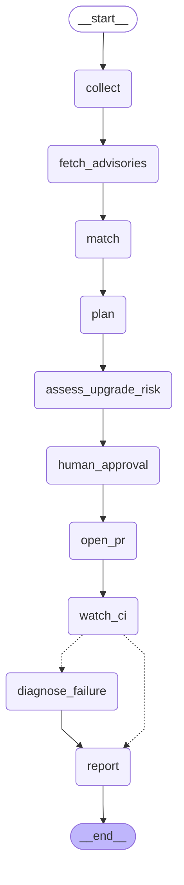

# Agent graph (LangGraph)

Generated by `python -m triage graph`. `human_approval` pauses the run (interrupt) until a human answers y/N; state is checkpointed in SQLite, so a paused run resumes by thread id. `diagnose_failure` only runs when an upgrade PR's CI is failing.

